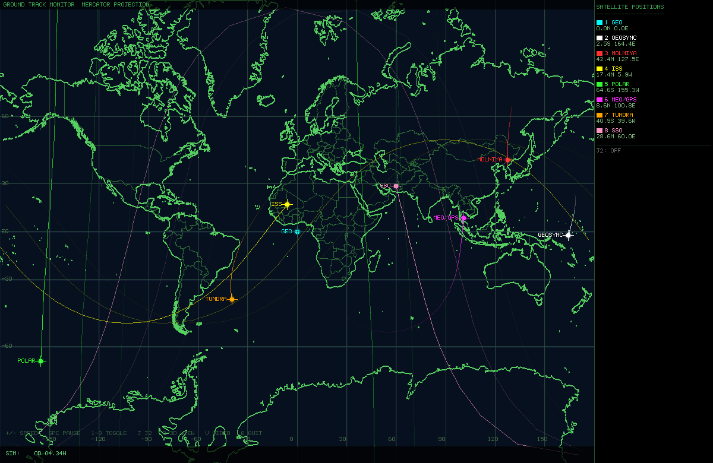

# Earth Satellite Orbit Simulation

A real-time 3D orbital mechanics simulation written in C with SDL2. Renders a
raycast Earth sphere with Lambert shading and a day/night terminator, eight
satellites spanning the full range of orbit families, and a Mercator ground
track monitor rendered from Natural Earth 1:50m geodata.



---

## Features

- **Raycast Earth renderer** — per-pixel sphere with land/ocean distinction,
  polar ice caps, lat/lon grid, atmospheric limb glow, and a physically correct
  day/night terminator (sun fixed at ECI +X).
- **Mercator ground track monitor** (`P`) — full-screen mission-control style
  map built from Natural Earth 1:50m coastlines and country borders, showing
  each satellite's current sub-satellite point and accumulated ground track
  history. Pressing `P` again returns to the 3D sphere view.
- **Eight orbit families** simultaneously simulated, with realistic orbital
  elements verified against real-world parameters:

  | # | Name | a (km) | e | i | Ω | Notes |
  |---|------|--------|---|---|---|-------|
  | 1 | GEO | 42 164 | 0 | 0° | 0° | Geostationary, equatorial |
  | 2 | GEOSYNC | 42 164 | 0 | 28° | 45° | Inclined geosynchronous, figure-8 ground track |
  | 3 | MOLNIYA | 26 560 | 0.74 | 63.4° | 40° | Apogee over eastern Siberia (~130°E), 12 h period |
  | 4 | ISS | 6 778 | 0 | 51.6° | 45° | ~407 km altitude, 92.5 min period |
  | 5 | POLAR | 7 000 | 0 | 90° | 90° | True polar LEO, 629 km |
  | 6 | MEO/GPS | 26 560 | 0 | 55° | 160° | GPS constellation representative, ~12 h period |
  | 7 | TUNDRA | 42 164 | 0.27 | 63.4° | 180° | Sirius-XM style, apogee over North America (~90°W) |
  | 8 | SSO | 7 178 | 0 | 98.7° | 130° | Sun-synchronous, 807 km, RAAN precesses with J2 |

- **Velocity Verlet integrator** at 20 s physics timestep with fractional
  accumulator — speed multiplier is exact regardless of frame rate.
- **J2 oblateness perturbation** (`J`) — toggleable zonal harmonic acceleration;
  makes SSO precess correctly, LEO nodes regress, and Molniya apogee rotate.
- **Ground track display** (`G`, 3D mode) — sub-satellite point projected onto
  the sphere surface with a nadir line from satellite to ground.
- **Ground track history** (map mode) — 1 500-point ring buffer per satellite
  (~41 h of history at default sampling), drawn with age-based alpha fade.
- **Orbit path overlay** — analytically computed Keplerian ellipses drawn
  separately from the Verlet state; behind-Earth segments dimmed.
- **Fading trails** — 500-point ECI ring buffer per satellite, sampled every
  5 physics steps (~100 s sim time).
- **MP4 video capture** (`V`) — pipes raw RGB24 frames to `ffmpeg`; output
  filename is timestamped. Works in both 3D and map modes.
- **Full 3D mouse rotation and zoom** covering all orbit sizes (scroll out to
  see Tundra/GEO simultaneously; scroll in to examine LEO details).
- **Embedded 5×7 bitmap font** — no font library dependency.

---

## Requirements

| Dependency | Notes |
|------------|-------|
| GCC ≥ 9 (C17) | or any C17-compliant compiler |
| SDL2 | `libsdl2-dev` on Debian/Ubuntu |
| `sdl2-config` | included with `libsdl2-dev` |
| `libm` | standard math library |
| Python 3 | for `gen_map_data.py` (run once at build time) |
| `ffmpeg` | **optional** — required only for video capture (`V` key) |

---

## Building

```bash
make          # builds ./earth_orbit  (runs gen_map_data.py on first build)
make run      # builds and launches
make clean    # removes the binary
make distclean  # removes binary, map_data.h, and downloaded tarball
```

On the first build, `make` runs `gen_map_data.py` which downloads the
`world-atlas@2.0.2` npm package (~2 MB, cached as `world-atlas-2.0.2.tgz`)
and generates `map_data.h` (~1.8 MB) containing Natural Earth 1:50m coastline
and country border coordinates as flat C arrays. Subsequent builds skip this
step entirely.

Direct compile (requires `map_data.h` to already exist):

```bash
gcc -O2 -std=c17 -o earth_orbit earth_orbit.c $(sdl2-config --cflags --libs) -lm
```

---

## Controls

| Input | Action |
|-------|--------|
| Left-drag | Rotate view (3D mode) |
| Scroll wheel | Zoom in / out (3D mode) |
| `+` / `=` | Double simulation speed |
| `-` | Halve simulation speed |
| `1` – `8` | Toggle individual satellite on/off |
| `R` | Reset view to default zoom and angle |
| `Space` | Pause / resume |
| `J` | Toggle J2 oblateness perturbation |
| `G` | Toggle ground track display (3D mode only) |
| `P` | Toggle Mercator ground track map / 3D sphere view |
| `V` | Start / stop MP4 video capture |
| `Q` / `Esc` | Quit |

Speed range: 1× – 1 000 000×. At the default 800× one GEO orbit takes about
13 s of wall time.

---

## Physics

### Integrator

Velocity Verlet at a fixed 20 s timestep. A fractional accumulator converts
real elapsed time to physics steps:

```
sim_acc += time_scale * dt_wall
while sim_acc >= DT: step(); sim_acc -= DT
```

Up to 600 steps are taken per frame to keep up at high speed multipliers.

### Gravity

Two-body point-mass gravity (always active):

```
a = −(GM / r³) · r⃗
```

With J2 enabled, the zonal harmonic correction is added:

```
factor = (3/2) · J₂ · GM · Rₑ² / r⁵

aₓ += factor · x · (1 − 5z²/r²)
aᵧ += factor · y · (1 − 5z²/r²)
a_z += factor · z · (3 − 5z²/r²)
```

where J₂ = 1.08263 × 10⁻³, Rₑ = 6 371 000 m, GM = 3.986004418 × 10¹⁴ m³/s².

### Initial conditions

Satellites are initialised from classical orbital elements via the Keplerian
solution: Kepler's equation solved by Newton's method (convergence to 10⁻¹³
rad), then transformed to ECI position and velocity through the perifocal frame
rotation (Ω, i, ω).

### Orbit placement rationale

The Molniya and Tundra orbits both use ω = 270° (argument of perigee),
which places apogee in the northern hemisphere at latitude ≈ i = 63.4°. The
ECI apogee longitude is 90° + Ω. RAAN values were chosen accordingly:

- **Molniya** Ω = 40° → ECI apogee lon 130°E (eastern Siberia), matching
  the Soviet-era operational Molniya coverage zone.
- **Tundra** Ω = 180° → ECI apogee lon 270°E = 90°W (North America),
  matching the Sirius XM Radio orbital geometry.

### Earth rotation

Earth rotation angle advances as `θ += Ω_E · dt` per physics step
(Ω_E = 7.292115 × 10⁻⁵ rad/s), keeping the ground tracks and Mercator
map in sync with the inertial satellite positions.

---

## Rendering pipeline

### 3D sphere mode

```
Per frame:
  1. Clear to black
  2. Draw star field (250 points, fixed positions)
  3. Lock streaming ARGB8888 texture → raycast Earth sphere
       pixel → view-space normal → ECI → Earth-fixed → lat/lon
       → land mask lookup → Lambert shading + ice/grid/limb glow
  4. Unlock + RenderCopy texture
  5. Draw orbit path ellipses (360 analytical Keplerian points each)
  6. [G] Draw ground track dots + nadir lines on sphere surface
  7. Draw satellite ECI trails + star-shaped markers
  8. Draw HUD (legend, status bar, controls hint)
  9. [V] SDL_RenderReadPixels → write RGB24 frame to ffmpeg pipe
 10. SDL_RenderPresent
```

### Mercator map mode (P)

```
Startup (once):
  1. Fill MAP_W × WIN_H pixel buffer with navy background + lat/lon grid
  2. Draw Natural Earth 1:50m country borders (362 arcs, 1 px, dim green)
  3. Draw Natural Earth 1:50m coastlines (1 597 arcs, 2 px, bright green)
     — Bresenham lines written directly into the pixel buffer
  4. Upload to static SDL_Texture (never redrawn)

Per frame:
  1. Blit static map texture (MAP_W = 1000 px wide, panel excluded)
  2. Draw ground track history lines with age-based alpha fade
     — antimeridian-crossing segments skipped
  3. Draw current sub-satellite position markers + crosshairs + labels
  4. Draw lat/lon axis tick labels
  5. Draw right panel (legend with live lat/lon per satellite)
  6. Draw status bar (sim time, speed, pause, REC indicator)
```

---

## Map data

The Mercator background is generated at first build from Natural Earth 1:50m
data via the `world-atlas@2.0.2` npm package (public domain / ISC licence).
`gen_map_data.py` decodes the TopoJSON arc format, splits arcs into coastlines
(used by the unified `land` object) and internal country borders (used by
`countries` but not `land`), and outputs `map_data.h` with flat `float[N][2]`
arrays ready for direct `#include`.

---

## Video capture

Press `V` to start recording. A timestamped `.mp4` file is created in the
working directory. Press `V` again to stop and finalize. The blinking `REC`
indicator appears in the bottom-right corner while recording. Works in both
3D and map modes.

The ffmpeg command used internally:

```
ffmpeg -y -f rawvideo -pixel_format rgb24 -video_size 1200x780 \
  -framerate 60 -i pipe:0 \
  -c:v libx264 -preset fast -crf 18 -pix_fmt yuv420p \
  earth_orbit_YYYYMMDD_HHMMSS.mp4
```

`ffmpeg` must be available in `$PATH`. If it is not found, a message is
printed to stderr and recording does not start. Play back with `ffplay`,
`mpv`, or `vlc`.

---

## File structure

```
earth_orbit.c        — complete simulation (~1 210 lines, single translation unit)
gen_map_data.py      — downloads world-atlas tarball, generates map_data.h
Makefile             — build rules, map_data.h dependency
README.md            — this file

Generated at build time (not committed):
map_data.h           — Natural Earth 1:50m C arrays (~1.8 MB, ~20 000 lines)
world-atlas-2.0.2.tgz — cached npm tarball (~2 MB)
```

---

## Constants

| Symbol | Value | Description |
|--------|-------|-------------|
| `RE` | 6 371 000 m | Earth mean radius |
| `GM` | 3.986004418 × 10¹⁴ m³/s² | Gravitational parameter |
| `Ω_E` | 7.2921150 × 10⁻⁵ rad/s | Earth rotation rate |
| `J₂` | 1.08263 × 10⁻³ | Second zonal harmonic |
| `DT_PHYS` | 20 s | Verlet timestep |
| `GT_LEN` | 1 500 points | Ground track history per satellite |
| `TRAIL_LEN` | 500 points | 3D ECI trail per satellite |
| `MAP_LAT_CLIP` | ±82° | Mercator latitude cutoff |

---

## License

Released into the public domain. Do whatever you like with it.
The Natural Earth geodata embedded in `map_data.h` is public domain.
The `world-atlas` npm package is ISC licensed.
